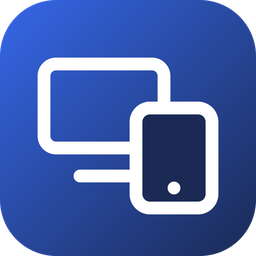
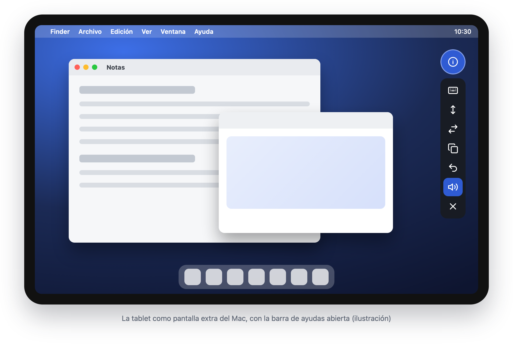
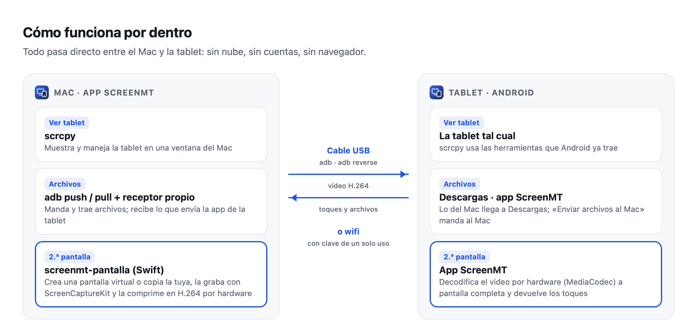
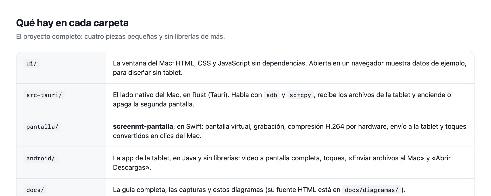
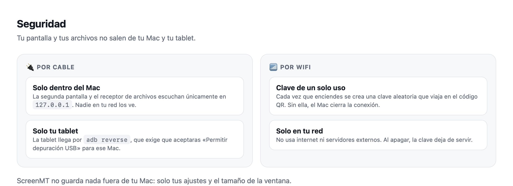

<p align="center">
  
</p>

<h1 align="center">ScreenMT</h1>

<p align="center"><b>Tu tablet Android y tu Mac, juntos.</b><br>
Maneja la tablet desde el Mac, pasa archivos en las dos direcciones y usa la tablet como segunda pantalla del Mac, por cable o por wifi.</p>

<p align="center">
  
  
</p>

<p align="center">
  <a href="../../releases/latest">Descargar</a> ·
  <a href="docs/GUIA.md">Guía completa</a> ·
  <a href="#cómo-funciona-por-dentro">Cómo funciona</a> ·
  <a href="#english">English</a>
</p>

<p align="center">
  
</p>

---

## Qué hace

| | |
|---|---|
| **Ver y manejar la tablet** | La pantalla de la tablet aparece en una ventana del Mac. La manejas con el ratón y el teclado, el sonido sale por el Mac y copiar y pegar funciona entre los dos. |
| **Archivos, Mac → tablet** | Arrastras archivos a ScreenMT y llegan a *Descargas* de la tablet. Un `.apk` arrastrado a la ventana de la tablet se instala. |
| **Archivos, tablet → Mac** | Desde el Mac: ves la lista de lo que hay en la tablet (descargas, documentos, fotos, capturas, videos), marcas y lo traes. Desde la tablet: en la app ScreenMT, *Enviar archivos al Mac*. |
| **Segunda pantalla** | La tablet se vuelve una **pantalla extra** del Mac, a la que arrastras ventanas, o una **copia** de tu pantalla. Va como video H.264 por hardware a la app ScreenMT de la tablet, a pantalla completa: sin navegador y con muy poca latencia. Eliges la calidad (cuatro niveles) y el tamaño de lo que ves; se ajusta solo al máximo que aguanta tu tablet. |
| **Tocar la tablet maneja el Mac** | Modo «un dedo», como el celular: deslizar desplaza (con inercia), tocar es clic, dejar el dedo quieto y mover arrastra, dos dedos es clic derecho y pellizcar acerca o aleja. También hay modo «ratón». |
| **Teclado y dictado** | El teclado de la tablet escribe en el Mac, también dictando con la voz, con una barra de teclas del Mac (Esc, Tab, flechas, copiar, pegar…). |
| **Barra de ayudas** | Un botón flotante que mueves a donde quieras: teclado, modo de toque, cambiar de app, ventanas, copiar, pegar, deshacer, bocinas, micrófono. |
| **Bocinas y micrófono de la tablet** | El sonido del Mac puede salir por la tablet, y el micrófono de la tablet puede usarse en el Mac (con BlackHole, gratuito). |
| **Por cable o por wifi** | Por cable es lo más rápido y no depende de la red. Por wifi, la tablet se empareja una vez (por cable o con un código QR) y después encuentra al Mac sola. |
| **Una ventana a tu medida** | Abre en 4:3 y se acomoda en dos columnas. También puede quedar angosta y pegarse al borde izquierdo o derecho del monitor, ideal para monitores ultrawide. Recuerda dónde la dejaste. |

Sin cuentas, sin nube y sin anuncios. Todo pasa entre tu Mac y tu tablet.

## Instalar

**Lo que necesitas:** un Mac con Apple Silicon (M1 o posterior) y macOS 13 o más nuevo, una tablet o un teléfono Android 7 o más nuevo, y un cable USB que transmita datos (no uno solo de carga).

1. **Instala las dos herramientas libres** en las que se apoya ScreenMT. Usa [Homebrew](https://brew.sh); en la Terminal:
   ```bash
   brew install scrcpy android-platform-tools
   ```
2. **Descarga `ScreenMT_…_aarch64.dmg`** de la [última versión](../../releases/latest), ábrelo y arrastra ScreenMT a *Aplicaciones*.
3. **La primera vez**, haz clic derecho en ScreenMT → *Abrir* → *Abrir*. La app no está firmada con una cuenta de desarrollador de Apple, por eso macOS pregunta una vez.
4. **En la tablet, activa la depuración USB**:
   - Ve a *Ajustes → Acerca de la tablet* y toca **7 veces** «Número de compilación».
   - Ve a *Ajustes → Sistema → Opciones de desarrollador* y activa **Depuración USB**.
   - Conecta el cable y, en la tablet, acepta **«¿Permitir depuración USB?»**. Marca «Permitir siempre desde este equipo».

Listo. ScreenMT muestra arriba el nombre de la tablet y su batería.

La **app de la tablet** (segunda pantalla y enviar archivos al Mac) la instala ScreenMT sola por el cable la primera vez que enciendes la segunda pantalla, o desde *Ajustes*. También está como `ScreenMT-tablet.apk` en cada versión.

👉 La **[guía completa](docs/GUIA.md)** explica cada pantalla, los permisos que pide macOS y qué hacer si algo falla.

## Uso rápido

- **Ver tablet** → *Abrir la tablet en el Mac*.
- **Archivos** → suelta archivos para enviarlos, o marca archivos de la lista → *Traer al Mac*. Llegan a *Descargas › Desde la tablet*, carpeta que puedes cambiar en Ajustes.
- **En la tablet**, la app ScreenMT → *Enviar archivos al Mac* (por cable) o *Abrir Descargas* para ver lo que llegó.
- **2.ª pantalla** → eliges *cable o wifi* y *pantalla extra o copia* → *Encender segunda pantalla*.
  - Por cable, la tablet la muestra sola.
  - Por wifi, escanea el código QR con la cámara de la tablet y se abre la app ScreenMT.
  - Para cerrarla, toca *Atrás* en la tablet o *Apagar segunda pantalla* en el Mac.
- Los **dos íconos de arriba a la derecha** pegan la ventana a la izquierda o a la derecha del monitor.

## Cómo funciona por dentro

<p align="center"></p>

<p align="center"></p>

<p align="center"></p>

Los diagramas se hacen con HTML (`docs/diagramas/`), así cualquiera puede corregirlos.

## Compilar desde el código

Necesitas Xcode Command Line Tools (`xcode-select --install`), [Rust](https://rustup.rs), Node.js 18 o más nuevo, y JDK 17 con el Android SDK (plataforma 36). El Android SDK lo trae Android Studio.

```bash
git clone https://github.com/JuanP30/ScreenMT.git
cd ScreenMT
npm install
npm run build      # compila screenmt-pantalla (Swift), la APK (Gradle) y la app (Tauri)
```

El resultado queda en `src-tauri/target/release/bundle/` (`.app` y `.dmg`). Para desarrollar con recarga: `npm run dev`. Para mirar solo el diseño: abre `ui/index.html#archivos` en el navegador.

## Limitaciones conocidas

- **La pantalla extra** usa una API privada de macOS (`CGVirtualDisplay`, la misma de DeskPad y BetterDisplay). Si una versión futura de macOS la cambia, el modo *copia* sigue funcionando.
- **Videos protegidos** (Netflix, Apple TV+, Disney+ y similares) se ven negros en la segunda pantalla. macOS no deja grabar ese contenido a ningún programa: es la protección anticopia de esos servicios (DRM), no un fallo de ScreenMT. Para verlos en la tablet, usa la app de ese servicio en la tablet.
- **Enviar archivos desde la tablet** funciona por cable; por wifi, usa el Mac para traerlos.
- **La velocidad por cable** depende del puerto de la tablet: muchas tablets tienen USB 2.0 (unos 36 MB/s para archivos).
- **Solo Mac con Apple Silicon** por ahora. Compilar para Intel es posible cambiando el `-target` en `pantalla/compilar.sh`.
- **La APK va firmada con una llave de depuración.** Sirve para instalarla a mano o desde ScreenMT, no para la Play Store.

## Créditos y licencia

ScreenMT es **código abierto bajo la [licencia MIT](LICENSE)**: úsalo, cámbialo y compártelo.

Se apoya en proyectos libres. Solo el generador de QR viene copiado dentro de este repositorio:

- [scrcpy](https://github.com/Genymobile/scrcpy) (Apache 2.0), para ver y manejar la tablet.
- [Android platform-tools / adb](https://developer.android.com/tools/releases/platform-tools), para la conexión con la tablet.
- [Tauri](https://tauri.app) (MIT/Apache 2.0), para la app del Mac.
- [QR Code Generator](https://github.com/kazuhikoarase/qrcode-generator) de Kazuhiko Arase (MIT), en `ui/qrcode.js`.

---

## English

**ScreenMT** lets you use an **Android tablet with your Mac**:
- **Mirror and control the tablet** in a Mac window, via scrcpy.
- **Move files both ways.** Drag and drop to send; pick from a list to bring files back.
- **Turn the tablet into a second display** for the Mac, as an *extended* virtual display or a *mirror*, over **USB** (adb reverse, no network needed) or **Wi‑Fi** (QR code with a one-time key).
  - Touch input controls the Mac: tap to click, drag to drag, long-press to right-click, two fingers to scroll.
  - Video is hardware-encoded H.264 (VideoToolbox) decoded by a tiny fullscreen Android app (MediaCodec): no browser, low latency.
- **Send files from the tablet** to the Mac with the same app.

The Mac window opens at 4:3 and can also snap as a narrow column to either side of the screen, which is great on ultrawide monitors.

**Install:**
1. `brew install scrcpy android-platform-tools`.
2. Get the `.dmg` from [Releases](../../releases/latest). The first time, open it with right-click → Open.
3. Enable *USB debugging* on the tablet.

The full guide is in Spanish ([docs/GUIA.md](docs/GUIA.md)). The UI is in Spanish too. Translations are welcome.

**Build:** `npm install && npm run build`. You need Rust, Node 18 or newer, Xcode CLT, JDK 17 and the Android SDK 36.

MIT licensed.
