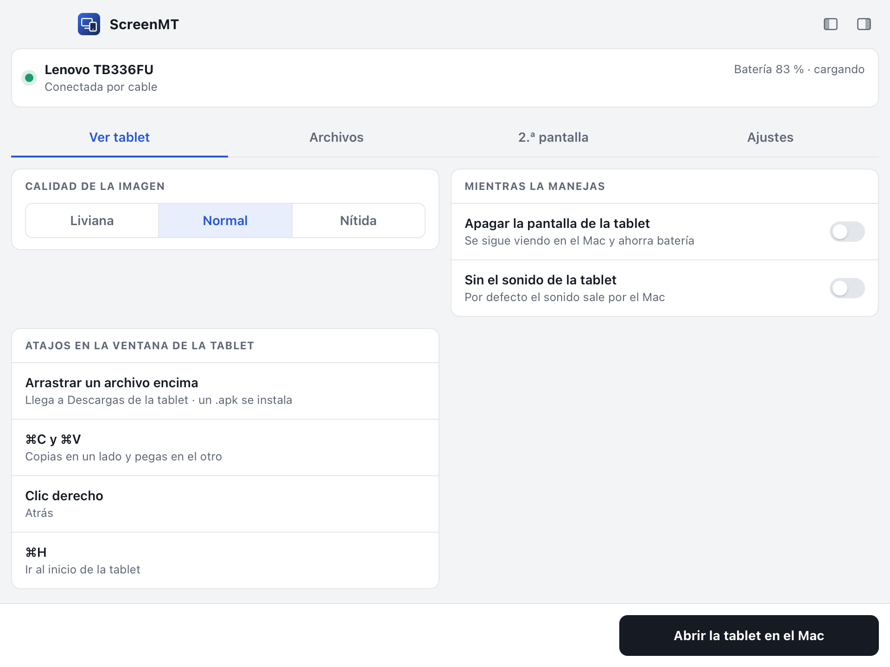
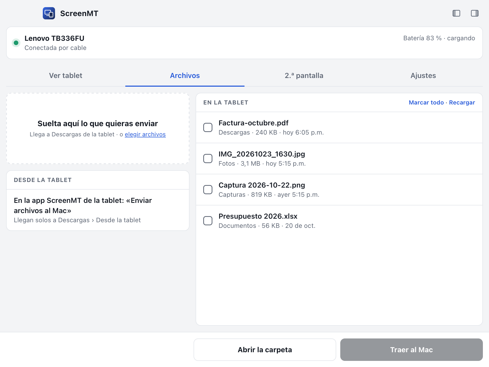
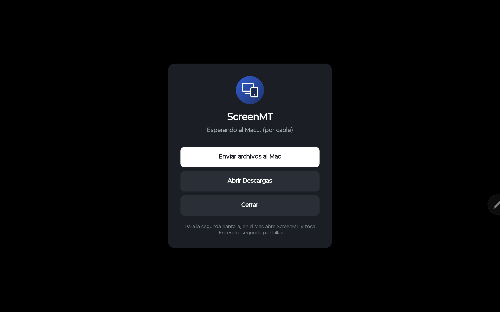
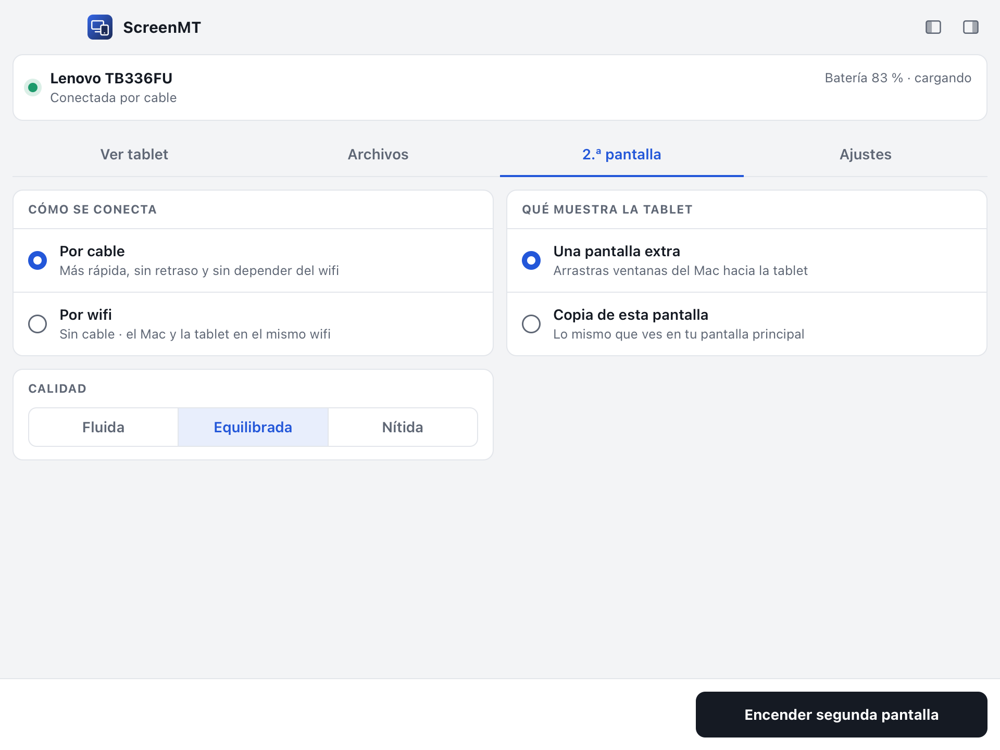
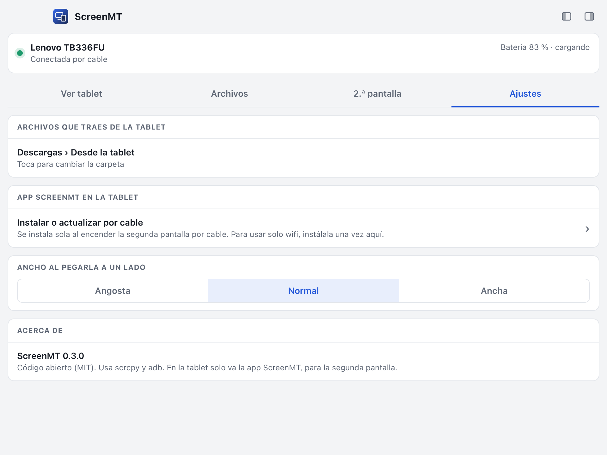

# Guía completa de ScreenMT

Esta guía explica todo, paso a paso, para que alguien que nunca ha conectado una tablet a un Mac lo logre a la primera.

- [1. Preparar el Mac](#1-preparar-el-mac)
- [2. Preparar la tablet](#2-preparar-la-tablet)
- [3. La ventana de ScreenMT](#3-la-ventana-de-screenmt)
- [4. Ver y manejar la tablet](#4-ver-y-manejar-la-tablet)
- [5. Pasar archivos](#5-pasar-archivos)
- [6. La tablet como segunda pantalla](#6-la-tablet-como-segunda-pantalla)
- [7. Ajustes](#7-ajustes)
- [8. Permisos que pide macOS](#8-permisos-que-pide-macos)
- [9. Si algo no funciona](#9-si-algo-no-funciona)
- [10. Preguntas frecuentes](#10-preguntas-frecuentes)

---

## 1. Preparar el Mac

1. Abre la app **Terminal** (⌘ + Espacio y escribe «Terminal»).
2. Si no tienes Homebrew, instálalo con el comando que aparece en [brew.sh](https://brew.sh).
3. Instala las dos herramientas que usa ScreenMT:
   ```bash
   brew install scrcpy android-platform-tools
   ```
   - **scrcpy** muestra y maneja la tablet en el Mac.
   - **adb** es la herramienta oficial de Android para hablar con la tablet por cable.
4. Descarga el `.dmg` de ScreenMT de la página de [versiones](../../../releases/latest), ábrelo y arrastra **ScreenMT** a **Aplicaciones**.
5. La **primera vez**, en *Aplicaciones*, haz **clic derecho en ScreenMT → Abrir → Abrir**. macOS lo pregunta una sola vez porque la app no está firmada con una cuenta paga de desarrollador de Apple.
   > Si macOS dice que la app «está dañada», abre la Terminal y escribe:
   > `xattr -dr com.apple.quarantine /Applications/ScreenMT.app`

> Si ya usas **Android Studio**, adb ya está en tu Mac y ScreenMT lo encuentra solo.

## 2. Preparar la tablet

Se hace **una sola vez** por tablet.

1. **Activa las opciones de desarrollador:** ve a *Ajustes → Acerca de la tablet* (en algunas marcas, *Acerca del dispositivo → Información de software*) y toca **7 veces** **«Número de compilación»**. Aparece «Ya eres desarrollador».
2. **Activa la depuración USB:** ve a *Ajustes → Sistema → Opciones de desarrollador* y activa **Depuración USB**.
3. **Conecta el cable** al Mac. Usa un cable que transmita datos: muchos cables que vienen con cargadores solo cargan.
4. En la tablet aparece **«¿Permitir depuración USB?»**. Marca **«Permitir siempre desde este equipo»** y toca **Permitir**.

En ScreenMT, arriba, aparecen el **nombre de la tablet**, **«Conectada por cable»** y su **batería**.

> Si la tablet pregunta qué hacer con la conexión USB («Solo cargar», «Transferir archivos»…), cualquier opción sirve: ScreenMT no la necesita.

## 3. La ventana de ScreenMT

<p align="center"></p>

- **Es una ventana normal:** la mueves, la cambias de tamaño y la cierras como cualquier otra. Su ícono está en el Dock.
- **Abre en proporción 4:3** y reparte su contenido en dos columnas. Si la angostas, todo queda en una columna.
- **Los dos íconos de arriba a la derecha** la pegan al **borde izquierdo** o **derecho** del monitor donde esté, a todo lo alto. En un monitor ultrawide queda como una columna y el resto de la pantalla te queda libre. El ancho lo eliges en *Ajustes*.
- **Recuerda** dónde y de qué tamaño la dejaste.
- **Arriba ves siempre** si la tablet está conectada, su batería y si la estás viendo en el Mac.
- **Tiene cuatro pestañas:** *Ver tablet*, *Archivos*, *2.ª pantalla* y *Ajustes*.
- **Funciona en modo claro y oscuro**: sigue el modo de tu Mac.

## 4. Ver y manejar la tablet

Toca **«Abrir la tablet en el Mac»**. Se abre una ventana con la pantalla de la tablet.

| Quiero… | Cómo |
|---|---|
| Tocar | Clic con el ratón |
| Escribir | Con el teclado del Mac |
| Volver atrás | Clic derecho |
| Ir al inicio | ⌘ H |
| Copiar y pegar entre los dos | ⌘ C en un lado y ⌘ V en el otro |
| Enviar un archivo | Arrastrarlo **encima de la ventana de la tablet** (llega a *Descargas*) |
| Instalar una app | Arrastrar el `.apk` encima de la ventana |

**Opciones** (antes de abrirla):
- **Calidad:** *Liviana* (1024 px), *Normal* (1400 px) o *Nítida* (1920 px). Si tu Mac va lento o el cable no es bueno, usa *Liviana*.
- **Apagar la pantalla de la tablet:** se sigue viendo en el Mac y la tablet ahorra batería.
- **Sin el sonido de la tablet:** por defecto, el sonido de la tablet sale por el Mac.

Si la ventana ya está abierta, el botón dice **«Traer la ventana al frente»**.

## 5. Pasar archivos

<p align="center"></p>

### Del Mac a la tablet
- **Arrastra** archivos del Finder a ScreenMT, sobre cualquier parte de la ventana; se pasa sola a la pestaña *Archivos*.
- O toca **«elegir archivos»**.

Llegan a **Descargas** de la tablet, y la tablet te abre esa carpeta para que los veas.

### De la tablet al Mac, desde la tablet
En la **app ScreenMT de la tablet**, toca **«Enviar archivos al Mac»** y elige uno o varios archivos. Llegan solos a la carpeta del Mac (por defecto *Descargas › Desde la tablet*) y ScreenMT te avisa. Funciona por cable, con ScreenMT abierta en el Mac.

<p align="center"></p>

**«Abrir Descargas»** abre la app Archivos de la tablet en Descargas, donde queda lo que mandas desde el Mac.

### De la tablet al Mac, desde el Mac
1. Abre la pestaña **Archivos**. La lista muestra lo que hay en *Descargas*, *Documentos*, *Fotos* (cámara), *Capturas*, *Imágenes* y *Videos*, con lo más nuevo arriba. De cada archivo ves la carpeta, el tamaño y la fecha.
2. **Marca** los que quieras (o **«Marcar todo»**).
3. Toca **«Traer al Mac»**.

Llegan a **Descargas › Desde la tablet** en el Mac (lo cambias en *Ajustes*) y esa carpeta se abre sola.

- **«Recargar»** vuelve a leer la tablet.
- La lista muestra hasta los 500 archivos más recientes.
- **Velocidad:** la marca el puerto de la tablet. Con USB 2.0, que tienen muchas tablets, son unos 36 MB/s: 1 GB tarda unos 30 segundos.

## 6. La tablet como segunda pantalla

<p align="center"></p>

Aquí la tablet **muestra el Mac**. Es lo contrario de *Ver tablet*. La imagen viaja como **video H.264 comprimido por hardware** y la app ScreenMT de la tablet lo decodifica también por hardware, a pantalla completa. No interviene ningún navegador.

### Elige
- **Cómo se conecta:**
  - **Por cable:** lo más rápido y estable. No usa el wifi.
  - **Por wifi:** sin cable. El Mac y la tablet tienen que estar **en el mismo wifi**.
- **Qué muestra la tablet:**
  - **Una pantalla extra:** el Mac cree que conectaste otro monitor. Arrastras ventanas hacia la tablet como a cualquier pantalla.
  - **Copia de esta pantalla:** la tablet muestra lo mismo que tu pantalla principal.
- **Calidad:**

  | Calidad | Qué hace | Ideal para |
  |---|---|---|
  | *Fluida* | La mitad del tamaño, 60 cuadros por segundo, 8 Mb/s | Wifi o equipos lentos |
  | *Equilibrada* | Algo menos nítida, siempre a 60 cuadros por segundo, 16 Mb/s | Lo más suave: videos, mover ventanas |
  | *Nítida* (por defecto) | El tamaño más grande que acepta tu tablet, 30 Mb/s | Leer, trabajar |
  | *Máxima* | Como Nítida con 50 Mb/s: casi sin compresión visible | Por cable, cuando quieres la mejor imagen |

  Cada tablet tiene un **tope de video** en su chip. La app de la tablet se lo dice al Mac y el Mac se ajusta solo. Por ejemplo, una Lenovo Idea Tab (chip MediaTek) muestra hasta 2304 × 1440 a 35 cuadros por segundo con *Nítida*, o 1804 × 1128 a 60 con *Equilibrada*. Lo que logra tu tablet aparece en ScreenMT al encender.
- **Tamaño de lo que ves** (solo en *pantalla extra*): *Grande* (como un Mac Retina, cómodo para tocar), *Mediano* o *Más espacio* (caben muchas más cosas, con letra pequeña).

### Encender
Toca **«Encender segunda pantalla»**.

- **Por cable:** ScreenMT **instala la app ScreenMT en la tablet** si hace falta y la **abre sola** a pantalla completa.
- **Por wifi:** aparece un **código QR**. Si la cámara de la tablet no lo enfoca, toca **«Mostrar el código grande»** y ocupa todo el monitor. Escanéalo con la **cámara de la tablet** y se abre la app ScreenMT, ya conectada a tu Mac. La app tiene que estar instalada: instálala una vez por cable desde *Ajustes*, o descarga `ScreenMT-tablet.apk` de la página de versiones.

<p align="center"></p>

### Cable o wifi en la app de la tablet
Arriba en la app ScreenMT de la tablet hay dos botones: **«Por cable»** y **«Por wifi»**. Cada uno espera al Mac por su lado y la app recuerda el último wifi que escaneaste. Si el Mac la abre por cable, se pasa sola a *Por cable*.

### Manejar el Mac tocando la tablet
| En la tablet | En el Mac |
|---|---|
| Tocar | Clic |
| Tocar y mover | Arrastrar |
| Dejar el dedo quieto | Clic derecho |
| Dos dedos a la vez, arriba o abajo (o a los lados) | Desplazar, como en el trackpad |

Para esto macOS pide el permiso de **Accesibilidad** (ver [permisos](#8-permisos-que-pide-macos)). Sin él, la tablet solo muestra la pantalla.

### Ordenar las pantallas (modo «pantalla extra»)
En *2.ª pantalla*, toca **«Ordenar las pantallas»**. Se abre *Ajustes del Sistema → Pantallas*: arrastra «Tablet (ScreenMT)» al lado de tu monitor donde la tengas físicamente, para que el ratón pase de una a otra por el borde correcto.

### Cerrar
- En la tablet: **Atrás**.
- En el Mac: **«Apagar segunda pantalla»**, o cerrar ScreenMT. Al cerrarla, la pantalla extra desaparece sola.

## 7. Ajustes

<p align="center"></p>

- **Archivos que traes de la tablet:** la carpeta del Mac donde llegan, tanto los que traes desde el Mac como los que mandas desde la tablet.
- **App ScreenMT en la tablet:** la instala o la actualiza por cable. Sirve si vas a usar solo wifi: se instala una vez y listo.
- **Ancho al pegarla a un lado:** *Angosta*, *Normal* o *Ancha*.

## 8. Permisos que pide macOS

ScreenMT pide permisos **solo para la segunda pantalla** y **solo cuando la usas**:

| Permiso | Para qué | Dónde se activa |
|---|---|---|
| **Grabación de pantalla** | Para mandar la imagen del Mac a la tablet | *Ajustes del Sistema → Privacidad y seguridad → Grabación de pantalla y audio* |
| **Accesibilidad** | Para que los toques de la tablet muevan el ratón del Mac | *Ajustes del Sistema → Privacidad y seguridad → Accesibilidad* |

Cuando falta un permiso, ScreenMT te muestra un botón que abre directamente ese lugar. Activa **ScreenMT**, **cierra ScreenMT y vuelve a abrirla**, porque macOS lo exige para el permiso de grabación.

> Si actualizas ScreenMT a una versión nueva, macOS puede pedir los permisos otra vez.

## 9. Si algo no funciona

| Lo que pasa | Qué hacer |
|---|---|
| **«No veo la tablet»** | Revisa el cable: prueba otro, porque muchos solo cargan. Desconecta y vuelve a conectar, y mira si la tablet pregunta «¿Permitir depuración USB?». Revisa que la *Depuración USB* siga activa. |
| **«No encuentro adb» o «No encuentro scrcpy»** | Corre `brew install scrcpy android-platform-tools` en la Terminal y vuelve a abrir ScreenMT. |
| **La lista de archivos sale vacía** | La tablet no tiene archivos en esas carpetas. Toca *Recargar* después de guardar algo. |
| **«Falta el permiso de Grabación de pantalla»** | Ve a la [sección 8](#8-permisos-que-pide-macos). Después de activarlo, cierra y abre ScreenMT. |
| **La tablet muestra «Esperando al Mac…»** | En el Mac, toca *Encender segunda pantalla*. Por wifi, revisa que los dos estén en el mismo wifi y vuelve a escanear el código, porque la clave cambia cada vez que se enciende. |
| **«No se pudo enviar» en la tablet** | Enviar desde la tablet funciona por cable: conecta el cable y deja ScreenMT abierta en el Mac. |
| **Por wifi va lenta** | Usa calidad *Fluida*, acerca la tablet al router o usa el cable. |
| **«El puerto 8730 está ocupado»** | Ya hay otra segunda pantalla encendida. Apágala o cierra y abre ScreenMT. |
| **La pantalla extra no aparece** | Prueba el modo *Copia de esta pantalla*. La pantalla extra usa una función interna de macOS que en alguna versión podría no estar. |
| **Un video sale negro** | Netflix, Apple TV+, Disney+ y similares protegen su video (DRM): macOS no deja que ningún programa lo grabe, así que en la segunda pantalla sale negro. Usa la app de ese servicio en la tablet. |

## 10. Preguntas frecuentes

**¿Necesito internet?** No. Por cable funciona sin red. Por wifi solo hace falta que el Mac y la tablet estén en la misma red de casa u oficina.

**¿Alguien más puede ver mi pantalla por wifi?** No sin la clave aleatoria que va en el código QR, y esa clave cambia cada vez que enciendes. Por cable, la pantalla ni siquiera sale a la red.

**¿Por qué Netflix no se ve en la segunda pantalla?** La segunda pantalla funciona grabando la imagen del Mac y mandándola a la tablet. Los servicios de video protegidos le piden a macOS que nadie pueda grabar su imagen, y macOS lo cumple con cualquier programa. Solo una pantalla conectada por HDMI o USB-C con protección HDCP puede mostrarlos.

**¿Sirve con un teléfono Android?** Sí: todo funciona igual. La segunda pantalla tendrá el tamaño del teléfono.

**¿Y con Windows o Linux?** Por ahora es solo para Mac. La pantalla extra y la grabación usan funciones propias de macOS.

**¿Cuesta algo?** No. Es código abierto bajo licencia MIT.
